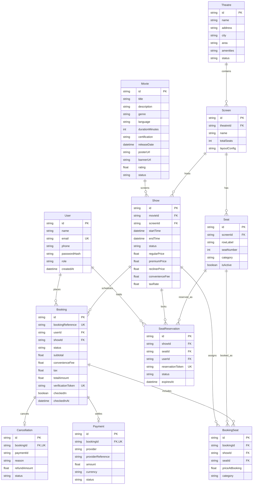
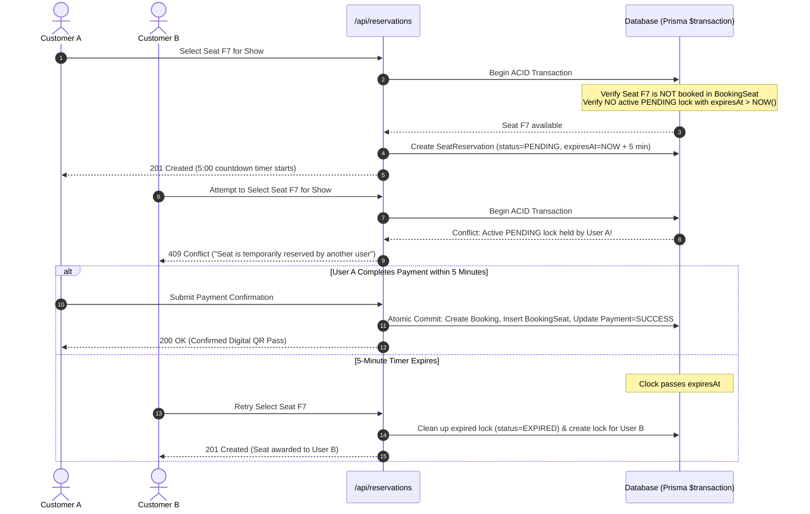

# CineBook — Movie Ticket Booking System
Full-Stack Web Application inspired by BookMyShow and District

[](https://nextjs.org/)
[](https://react.dev/)
[](https://www.typescriptlang.org/)
[](https://tailwindcss.com/)
[](https://www.prisma.io/)
[](https://www.postgresql.org/)
[](https://opensource.org/licenses/MIT)

---

## Table of Contents
1. [Project Overview](#1-project-overview)
2. [Technology Stack](#2-technology-stack)
3. [System Architecture](#3-system-architecture)
4. [Database Design & Schema Specification](#4-database-design--schema-specification)
   - [Entity Relationship Diagram](#entity-relationship-diagram-er)
   - [Database Tables & Fields](#database-tables--fields)
5. [Concurrency Control & Seat Reservation Locking](#5-concurrency-control--seat-reservation-locking)
6. [Project Directory Structure](#6-project-directory-structure)
7. [REST API Endpoints](#7-rest-api-endpoints)
8. [Movie Catalogue & Hyderabad Theatres](#8-movie-catalogue--hyderabad-theatres)
9. [Local Setup & Getting Started](#9-local-setup--getting-started)
10. [Automated Testing & Verification](#10-automated-testing--verification)
11. [Security & Compliance](#11-security--compliance)
12. [License & Academic Disclaimer](#12-license--academic-disclaimer)

---

## 1. Project Overview

**CineBook** is an enterprise-grade, realistic, full-stack Movie Ticket Booking System engineered for modern cinema operations in **Hyderabad, Telangana**. Built as an academic Software Engineering project, it demonstrates software architectural principles, database transaction atomicity, distributed seat reservation concurrency control, role-based security, and contactless digital ticketing.

### Key Highlights
* **High-Concurrency Seat Locking**: Solves double-booking race conditions by employing atomic database transactions (`prisma.$transaction`) combined with temporary seat reservations on a 5-minute countdown timer.
* **Interactive Multiplex Seating Map**: Responsive, touch-optimized seat layouts representing distinct seating tiers (Regular, Premium, VIP Recliner Lounge, and Accessible) with curved screen visualizers and aisle spacing.
* **Authentic Movie Metadata & Theatrical Posters**: Real, verified high-resolution artwork and accurate regional movie listings (e.g. *Ranabaali*, *Aadarsha Kutumbam House No: 47*, *Kalki 2898 AD*, *Pushpa 2: The Rule*, *Devara: Part 1*).
* **Realistic Hyderabad Multiplex Hubs**: Accurate listings for premier theatres such as AMB Cinemas Gachibowli, PVR ICON Hitech City, Prasads Multiplex Necklace Road, and INOX GVK One Banjara Hills with laser projection, Dolby Atmos, and 4DX capabilities.
* **Cryptographic Digital Tickets & Verification**: Generates cryptographically unique verification tokens and live scannable QR codes with an integrated staff ticket scanner and admission portal.
* **Secure Session-Based Authentication**: HTTP-only secure cookie sessions, JSON Web Tokens (JWT), salted bcrypt password hashing, and role-based route middleware (`CUSTOMER` vs. `ADMIN`).
* **Administration Suite**: Real-time management of cinema venues, auditoriums, scheduled shows, dynamic tier pricing, and operational revenue analytics.

---

## 2. Technology Stack

### Frontend Layer
| Technology | Version | Purpose |
| :--- | :--- | :--- |
| **Next.js (App Router)** | 16.4 | React full-stack framework with Server & Client Component architecture |
| **React** | 19.0 | UI component model, reactive state hooks, and client hydration |
| **TypeScript** | 5.9 | Static type safety, interfaces, and compile-time contract enforcement |
| **Tailwind CSS** | 4.0 | Modern utility-first styling with custom dark cinematic purple design system |
| **Lucide Icons** | 0.5+ | High-performance SVG iconography across navigation, badges, and controls |
| **QRCode** | 1.5 | Dynamic cryptographic QR code generation for mobile admission passes |

### Backend & API Layer
| Technology | Version | Purpose |
| :--- | :--- | :--- |
| **Next.js Server Handlers**| 16.4 | High-performance RESTful API endpoints at `/api/*` |
| **Jose (JWT)** | 6.0 | Cryptographic JSON Web Token signing and verification (`HS256`) |
| **bcryptjs** | 3.0 | Secure password salting and hashing (10 salt rounds) |
| **HTTP-Only Cookies** | Native | Tamper-proof session storage preventing client-side XSS exploitation |
| **Next.js Proxy/Middleware**| 16.4 | Server-side route protection for authenticated and administrative pages |

### Database & Persistence Layer
| Technology | Version | Purpose |
| :--- | :--- | :--- |
| **Prisma ORM** | 6.4 | Next-generation declarative ORM with type-safe client generation |
| **SQLite (Local Dev)** | 3.x | Zero-dependency, zero-setup local relational storage (`file:./dev.db`) |
| **PostgreSQL (Production)**| 16+ | Enterprise relational database schema provided (`prisma/schema.postgresql.prisma`) |
| **Docker & Compose** | 3.8 | Reproducible container configuration for PostgreSQL production deployments |

### Testing & Tooling
| Technology | Purpose |
| :--- | :--- |
| **Node.js Test Runner** | Native Node.js test suite (`node:test`, `node:assert`) with 10 passing tests |
| **tsx** | Zero-config TypeScript execution for tests and database seeding scripts |

---

## 3. System Architecture

CineBook utilizes a **Modular Layered Architecture** with unidirectional data flow and strict boundary separation:

```
┌────────────────────────────────────────────────────────────────────────┐
│                        PRESENTATION LAYER                              │
│   Next.js 16 App Router (React 19) • Tailwind CSS v4 • Lucide Icons   │
│   - Customer Portal: Home Hero, Catalogue, Details, Interactive Seat Map│
│   - Checkout Flow: 5-Min Timer, Simulated Payment, Digital QR Ticket   │
│   - Management Suite: Admin Analytics, Shows, Theatres, Staff Scanner  │
└────────────────────────────────────┬───────────────────────────────────┘
                                     │ HTTPS / JSON / Cookies
┌────────────────────────────────────▼───────────────────────────────────┐
│                     APPLICATION & API GATEWAY LAYER                    │
│   Next.js Route Handlers (`/api/*`) • Middleware Guard • Jose JWT     │
│   - Session Verification (HTTP-only cookies)                           │
│   - Role-Based Access Control (RBAC: CUSTOMER | ADMIN)                 │
│   - Business Logic & Pricing Calculations (Subtotal + Fees + Taxes)    │
└────────────────────────────────────┬───────────────────────────────────┘
                                     │ ACID Transactions (`$transaction`)
┌────────────────────────────────────▼───────────────────────────────────┐
│                      DATA ACCESS & ORM LAYER                           │
│   Prisma ORM 6.4 Client Singletons (`src/lib/prisma.ts`)               │
│   - Temporary Seat Reservation Locking & Expiration Engine             │
│   - Payment State Transition Validation                                │
│   - Relational Cascades & Foreign Key Integrity                        │
└────────────────────────────────────┬───────────────────────────────────┘
                                     │ SQL Queries & Indexes
┌────────────────────────────────────▼───────────────────────────────────┐
│                         RELATIONAL DATABASE                            │
│   SQLite (`dev.db`) for Local / PostgreSQL for Docker Production       │
└────────────────────────────────────────────────────────────────────────┘
```

---

## 4. Database Design & Schema Specification

The database utilizes **10 normalized relational models** designed with strict foreign key constraints, unique indexes, and audit timestamps.

### Entity Relationship Diagram (ER)



---

### Database Tables & Fields

#### 1. `User` (Customer and Admin Accounts)
Stores credentials, profile details, and role assignments.
* `id` (`String`, PK): Unique CUID identifier.
* `name` (`String`): Full name.
* `email` (`String`, Unique, Indexed): Login email address.
* `phone` (`String?`): Contact phone number.
* `passwordHash` (`String`): Salted bcrypt hashed password.
* `role` (`String`, Default: `"CUSTOMER"`): Authorization level (`CUSTOMER` | `ADMIN`).
* `createdAt` / `updatedAt` (`DateTime`): Audit timestamps.

#### 2. `Movie` (Film Titles & Metadata)
Stores full theatrical catalogue with authentic metadata and regional classifications.
* `id` (`String`, PK): Unique CUID.
* `title` (`String`): Official movie title.
* `description` (`String`): Synopsis and story logline.
* `genre` (`String`): Comma-separated genre list (e.g., `"Action, Sci-Fi, Mythology"`).
* `language` (`String`): Available audio tracks (e.g., `"Telugu, Hindi, Tamil"`).
* `durationMinutes` (`Int`): Runtime in minutes.
* `certification` (`String`, Default: `"U/A"`): Censor rating (`U`, `UA`, `A`).
* `releaseDate` (`DateTime`, Indexed): Theatrical premiere date.
* `posterUrl` (`String?`): 2:3 vertical poster path in `/public/posters/`.
* `bannerUrl` (`String?`): High-res backdrop image path.
* `trailerUrl` (`String?`): External promotional video link.
* `cast` (`String?`): Serialized JSON array of principal cast with roles.
* `crew` (`String?`): Serialized JSON array of directors and music directors.
* `rating` (`Float?`): Audience rating out of 10.
* `status` (`String`, Indexed, Default: `"COMING_SOON"`): Theatrical release status (`NOW_SHOWING` | `COMING_SOON` | `INACTIVE`).

#### 3. `Theatre` (Multiplex Venues)
Physical multiplex cinema establishments in Hyderabad.
* `id` (`String`, PK): Unique CUID.
* `name` (`String`): Multiplex name (e.g., `"AMB Cinemas"`).
* `address` (`String`): Full street address.
* `city` (`String`, Indexed): City location (`"Hyderabad"`).
* `area` (`String`): Neighborhood (e.g., `"Gachibowli"`, `"Hitech City"`).
* `phone` / `email` (`String?`): Venue contact details.
* `amenities` (`String`): Comma-separated list of amenities (e.g., `"4K Laser, Dolby Atmos, VIP Recliner Lounge"`).
* `status` (`String`, Indexed, Default: `"ACTIVE"`): Operational status.

#### 4. `Screen` (Cinema Auditoriums)
Individual screening auditoriums inside a theatre.
* `id` (`String`, PK): Unique CUID.
* `theatreId` (`String`, FK, Indexed): References `Theatre.id` with `onDelete: Cascade`.
* `name` (`String`): Screen identifier (e.g., `"Screen 1 (Laser 4K Atmos)"`, `"Screen 6 (Prasads PCX)"`).
* `totalSeats` (`Int`): Total seating capacity.
* `layoutConfig` (`String?`): JSON string defining rows, columns, and aisle positions.

#### 5. `Seat` (Physical Hall Seats)
Individual seat positions within an auditorium.
* `id` (`String`, PK): Unique CUID.
* `screenId` (`String`, FK, Indexed): References `Screen.id` with `onDelete: Cascade`.
* `rowLabel` (`String`): Row identifier (`A`, `B`, `C` ...).
* `seatNumber` (`Int`): Seat index within row (1, 2, 3 ...).
* `category` (`String`, Indexed, Default: `"REGULAR"`): Seating class (`REGULAR`, `PREMIUM`, `RECLINER`, `ACCESSIBLE`).
* `isActive` (`Boolean`, Default: `true`): Operational state.
* **Unique Constraint**: `@@unique([screenId, rowLabel, seatNumber])` ensures no duplicate physical seat labels per screen.

#### 6. `Show` (Scheduled Screenings)
Time-specific movie screening instances in a given auditorium.
* `id` (`String`, PK): Unique CUID.
* `movieId` (`String`, FK, Indexed): References `Movie.id`.
* `screenId` (`String`, FK, Indexed): References `Screen.id`.
* `startTime` / `endTime` (`DateTime`, Indexed): Screening time interval.
* `status` (`String`, Indexed, Default: `"SCHEDULED"`): Lifecycle state (`SCHEDULED` | `ACTIVE` | `CANCELLED` | `COMPLETED`).
* `regularPrice` (`Float`): Base regular seat ticket price (INR).
* `premiumPrice` (`Float`): Premium seat ticket price (INR).
* `reclinerPrice` (`Float`): Luxury VIP recliner seat ticket price (INR).
* `convenienceFee` (`Float`, Default: `30`): Per-booking service fee.
* `taxRate` (`Float`, Default: `0.18`): Applicable GST tax rate (18%).

#### 7. `SeatReservation` (Temporary Seat Locking)
Temporary locks created during seat selection to prevent double bookings.
* `id` (`String`, PK): Unique CUID.
* `showId` (`String`, FK, Indexed): References `Show.id`.
* `seatId` (`String`, FK): References `Seat.id`.
* `userId` (`String`, FK, Indexed): User holding the temporary lock.
* `reservationToken` (`String`, Unique): Random token validating checkout ownership.
* `status` (`String`, Default: `"PENDING"`): Lock state (`PENDING` | `CONFIRMED` | `EXPIRED` | `RELEASED`).
* `expiresAt` (`DateTime`, Indexed): Strict expiration deadline (typically `now() + 5 minutes`).
* **Unique Constraint**: `@@unique([showId, seatId, status])`.

#### 8. `Booking` (Customer Bookings)
Created upon proceeding to checkout; finalized upon payment.
* `id` (`String`, PK): Unique CUID.
* `bookingReference` (`String`, Unique, Indexed): Customer-facing alphanumeric identifier (e.g., `CB-784912`).
* `userId` (`String`, FK, Indexed): Booking customer.
* `showId` (`String`, FK, Indexed): Associated screening.
* `status` (`String`, Default: `"PENDING"`): Status (`PENDING` | `CONFIRMED` | `CANCELLED` | `FAILED`).
* `subtotal` (`Float`): Sum of ticket prices.
* `convenienceFee` (`Float`): Service charge.
* `tax` (`Float`): GST component calculated on subtotal.
* `totalAmount` (`Float`): Final payable amount.
* `verificationToken` (`String`, Unique): Cryptographic token embedded inside the digital QR code.
* `checkedIn` (`Boolean`, Default: `false`): Scanned entry status.
* `checkedInAt` (`DateTime?`): Timestamp of cinema hall check-in.

#### 9. `BookingSeat` (Booked Seat Junction)
Immutable record of seats allocated to a confirmed booking.
* `id` (`String`, PK): Unique CUID.
* `bookingId` (`String`, FK, Indexed): References `Booking.id` with `onDelete: Cascade`.
* `showId` (`String`, FK): References `Show.id`.
* `seatId` (`String`, FK, Indexed): References `Seat.id`.
* `priceAtBooking` (`Float`): Snapshot price at the exact moment of transaction.
* `category` (`String`): Category snapshot (`REGULAR`, `PREMIUM`, `RECLINER`).
* **Unique Constraint**: `@@unique([showId, seatId])` guarantees at the database level that a physical seat can **never** be double-booked for the same show.

#### 10. `Payment` (Transaction Ledger)
Simulated payment execution ledger.
* `id` (`String`, PK): Unique CUID.
* `bookingId` (`String`, Unique, Indexed): Associated booking.
* `provider` (`String`, Default: `"DEMO"`): Gateway provider name.
* `providerReference` (`String?`): External transaction ID (e.g., `DEMO-1760183921`).
* `amount` (`Float`): Captured monetary amount.
* `currency` (`String`, Default: `"INR"`): Currency denomination.
* `status` (`String`, Default: `"PENDING"`): Gateway status (`PENDING` | `SUCCESS` | `FAILED` | `REFUNDED`).
* `metadata` (`String?`): Gateway response payload.

#### 11. `Cancellation` (Refund Audit Trail)
Customer cancellation and refund tracking.
* `id` (`String`, PK): Unique CUID.
* `bookingId` (`String`, Unique, Indexed): Cancelled booking.
* `paymentId` (`String?`): Associated payment transaction ID.
* `reason` (`String?`): Cancellation note.
* `refundAmount` (`Float`): Amount refunded after cancellation rules (75% refund policy).
* `status` (`String`, Default: `"PENDING"`): (`PENDING` | `APPROVED` | `REFUNDED`).

---

## 5. Concurrency Control & Seat Reservation Locking

To replicate the concurrency guarantees of production ticketing platforms, CineBook implements a **Two-Phase Reservation Protocol**:



### Concurrency Guarantees
1. **Zero Double-Bookings**: The composite unique constraint `@@unique([showId, seatId])` on `BookingSeat` prevents any physical possibility of double-allocating a seat.
2. **Deterministic Timeouts**: Locks are bound to `expiresAt` timestamps. No long-running background worker is required; expiration is checked deterministically on every read and write query.
3. **Multi-Show Isolation**: The same physical seat in an auditorium can be booked for Show 1 (10:30 AM) and Show 2 (02:15 PM) independently without conflict.

---

## 6. Project Directory Structure

```
cinebook/
├── docs/                                 # Architectural & academic documentation
│   └── CineBook_Project_Overview.pdf     # Compiled formal project report
├── prisma/
│   ├── dev.db                            # Local SQLite database binary (git-ignored)
│   ├── schema.prisma                     # Active Prisma schema (SQLite local execution)
│   ├── schema.postgresql.prisma          # PostgreSQL production schema (Docker/Cloud)
│   └── seed.ts                           # Comprehensive seed script (15 films, 4 theatres)
├── public/                               # Public static assets
│   └── posters/                          # Authentic high-resolution theatrical posters
│       ├── adarsha-kutumbam.jpg          # Official #AK47 first look
│       ├── crazy-kalyanam.jpg            # Crazy Kalyanam promotional poster
│       ├── devara-part-1.jpg             # Devara: Part 1 official poster
│       ├── game-changer.jpg              # Game Changer official poster
│       ├── garividi-lakshmi.jpg          # Garividi Lakshmi theatrical poster
│       ├── itllu-arjuna.jpg              # Itllu Arjuna official promotional poster
│       ├── jailer-2.jpg                  # Jailer 2 announcement poster
│       ├── kalki-2898-ad.jpg             # Kalki 2898 AD theatrical poster
│       ├── lucky-baskhar.jpg             # Lucky Baskhar official poster
│       ├── mathu-vadalara-2.jpg          # Mathu Vadalara 2 official poster
│       ├── pushpa-2-the-rule.jpg         # Pushpa 2: The Rule theatrical poster
│       ├── ranabaali.jpg                 # Ranabaali official theatrical artwork
│       ├── ranabaali-banner.jpg          # Ranabaali wide landscape banner
│       ├── sankranthiki-vasthunam.jpg    # Sankranthiki Vasthunam poster
│       ├── they-call-him-og.jpg          # They Call Him OG official poster
│       └── vishwambhara.jpg              # Vishwambhara promotional artwork
├── src/
│   ├── app/                              # Next.js 16 App Router pages and API routes
│   │   ├── (auth)/
│   │   │   ├── login/page.tsx            # Customer & Admin login with validation
│   │   │   └── register/page.tsx         # Account registration page
│   │   ├── admin/                        # Administrative management dashboard
│   │   │   ├── page.tsx                  # Real-time metrics, revenue, and stats
│   │   │   ├── bookings/page.tsx         # Global bookings table & status oversight
│   │   │   ├── movies/page.tsx           # Film catalogue CRUD manager
│   │   │   ├── shows/page.tsx            # Screening scheduler & pricing controls
│   │   │   └── theatres/page.tsx         # Multiplex and auditorium manager
│   │   ├── api/                          # RESTful Backend API Route Handlers
│   │   │   ├── admin/stats/route.ts      # Revenue, bookings, and occupancy statistics
│   │   │   ├── auth/
│   │   │   │   ├── login/route.ts        # Password validation & JWT cookie issuance
│   │   │   │   ├── logout/route.ts       # Secure cookie clearing
│   │   │   │   ├── me/route.ts           # Active session identification
│   │   │   │   └── register/route.ts     # User creation with bcrypt hashing
│   │   │   ├── bookings/
│   │   │   │   ├── route.ts              # Customer bookings list & reservation finalization
│   │   │   │   └── [reference]/
│   │   │   │       ├── route.ts          # Individual booking lookup by reference code
│   │   │   │       └── cancel/route.ts   # Cancellation request & 75% refund policy
│   │   │   ├── movies/
│   │   │   │   ├── route.ts              # Catalogue queries with search, genre & status filters
│   │   │   │   └── [id]/route.ts         # Single movie details with active screenings
│   │   │   ├── payments/route.ts         # Simulated payment success/failure state machine
│   │   │   ├── profile/route.ts          # Profile information retrieval and updates
│   │   │   ├── reservations/route.ts     # ACID temporary seat reservation & release handler
│   │   │   ├── shows/
│   │   │   │   ├── route.ts              # Date & theatre show queries with seat counts
│   │   │   │   └── [id]/
│   │   │   │       ├── route.ts          # Single show metadata with pricing tiers
│   │   │   │       └── seats/route.ts    # Real-time physical seat map availability
│   │   │   ├── theatres/
│   │   │   │   ├── route.ts              # Hyderabad multiplexes with screen capacities
│   │   │   │   └── [id]/route.ts         # Specific venue screen layouts
│   │   │   └── verify-ticket/route.ts    # QR token admission scanner & check-in verification
│   │   ├── booking/success/[reference]/  # Post-payment confirmation page
│   │   ├── checkout/[id]/page.tsx        # Order summary, breakdown & timer review
│   │   ├── movies/
│   │   │   ├── page.tsx                  # Browse movies with quick-filter chips & search
│   │   │   └── [id]/page.tsx             # Movie hero, cast, showtimes, or Coming Soon notice
│   │   ├── my-bookings/page.tsx          # User booking history with past/active tickets
│   │   ├── payment/[id]/page.tsx         # Payment gateway simulator (Test Success / Failure)
│   │   ├── profile/page.tsx              # Account details and phone updates
│   │   ├── shows/[id]/seats/page.tsx     # Interactive SVG seat map & sticky checkout bar
│   │   ├── theatres/page.tsx             # Hyderabad multiplexes overview
│   │   ├── ticket/[reference]/page.tsx   # Mobile digital pass with live QR code
│   │   ├── verify-ticket/page.tsx        # Staff admission scanner portal
│   │   ├── layout.tsx                    # Root layout with Navbar, Footer, and Toast notifications
│   │   ├── page.tsx                      # Home page: Hero banner, Now Showing, Coming Soon
│   │   └── globals.css                   # Tailwind v4 theme, seat statuses & layout utilities
│   ├── components/
│   │   ├── layout/
│   │   │   ├── Navbar.tsx                # Responsive navigation with search & profile drawer
│   │   │   └── Footer.tsx                # Comprehensive footer with demo disclaimers
│   │   ├── movies/
│   │   │   └── MovieCard.tsx             # 2:3 aspect ratio card with rating & status badges
│   │   └── ui/
│   │       ├── LoadingSpinner.tsx        # Skeleton loaders & spinners
│   │       └── Toaster.tsx               # Reactive toast notification system
│   ├── lib/
│   │   ├── auth.ts                       # Jose JWT token signing, verification & session helpers
│   │   ├── prisma.ts                     # Prisma Client singleton
│   │   └── session.ts                    # HTTP-only cookie serialization
│   └── middleware.ts                     # Edge route guard protecting user & admin paths
├── tests/
│   └── business-logic.test.ts            # Integration test suite (10 automated test cases)
├── .env.example                          # Sample environment configuration template
├── .gitignore                            # Excludes node_modules, .next, and sqlite databases
├── docker-compose.yml                    # Container configuration for PostgreSQL
├── next.config.ts                        # Next.js config with Turbopack & remote image patterns
├── package.json                          # Dependencies & NPM scripts
└── tsconfig.json                         # TypeScript configuration (Strict Mode)
```

---

## 7. REST API Endpoints

| Category | Method | Route | Access | Description |
| :--- | :--- | :--- | :--- | :--- |
| **Auth** | `POST` | `/api/auth/register` | Public | Register new user account with bcrypt password hashing |
| **Auth** | `POST` | `/api/auth/login` | Public | Verify credentials and issue HTTP-only JWT session cookie |
| **Auth** | `POST` | `/api/auth/logout` | Public | Invalidate and clear session cookie |
| **Auth** | `GET` | `/api/auth/me` | Authenticated | Fetch authenticated user session profile |
| **Movies** | `GET` | `/api/movies` | Public | List movies with `status`, `genre`, `language`, and `search` query parameters |
| **Movies** | `GET` | `/api/movies/[id]` | Public | Fetch film details with scheduled showtimes |
| **Movies** | `POST` | `/api/movies` | Admin | Create a new movie record |
| **Theatres** | `GET` | `/api/theatres` | Public | List theatres filtered by `city` with screen counts |
| **Theatres** | `GET` | `/api/theatres/[id]`| Public | Fetch multiplex screens and layout configurations |
| **Shows** | `GET` | `/api/shows` | Public | Query showtimes by `movieId`, `theatreId`, or `date` with seat availability |
| **Shows** | `GET` | `/api/shows/[id]` | Public | Fetch show metadata and seat status map |
| **Shows** | `GET` | `/api/shows/[id]/seats`| Public | Fetch all seats with live status (`AVAILABLE`, `RESERVED`, `BOOKED`) |
| **Reservations** | `POST`| `/api/reservations` | Authenticated | Atomically lock selected seats for 5 minutes (`PENDING`) |
| **Reservations** | `DELETE`| `/api/reservations` | Authenticated | Explicitly release locked seats |
| **Bookings** | `GET` | `/api/bookings` | Authenticated | List user bookings (or all bookings for admin) |
| **Bookings** | `POST` | `/api/bookings` | Authenticated | Finalize reservation and create pending booking |
| **Bookings** | `GET` | `/api/bookings/[reference]` | Authenticated | Retrieve booking summary, seats, and payment status |
| **Bookings** | `POST` | `/api/bookings/[reference]/cancel`| Authenticated | Cancel confirmed booking (enforces > 2h cutoff; 75% refund) |
| **Payments** | `POST` | `/api/payments` | Authenticated | Simulated payment processor (`action: SUCCESS` or `FAILURE`) |
| **Staff QR** | `GET` | `/api/verify-ticket?token=...` | Public | Verify authenticity of digital QR pass token |
| **Staff QR** | `POST` | `/api/verify-ticket` | Public | Check in customer and record admission timestamp |
| **Admin** | `GET` | `/api/admin/stats` | Admin | Aggregate total movies, shows, bookings, and revenue metrics |

---

## 8. Movie Catalogue & Hyderabad Theatres

### Now Showing Films (Actively Screened in Hyderabad)
1. **Kalki 2898 AD** (181m • UA • 8.4★) — Sci-Fi / Mythology starring Prabhas, Amitabh Bachchan, Deepika Padukone.
2. **Pushpa 2: The Rule** (200m • A • 8.6★) — Action / Crime starring Allu Arjun, Rashmika Mandanna, Fahadh Faasil.
3. **Devara: Part 1** (178m • UA • 7.9★) — Coastal Action / Drama starring NTR Jr., Janhvi Kapoor, Saif Ali Khan.
4. **Game Changer** (170m • UA • 7.5★) — Political Action starring Ram Charan, Kiara Advani, S. J. Suryah.
5. **Mathu Vadalara 2** (138m • UA • 8.0★) — Comedy / Crime starring Sri Simha Koduri, Satya, Faria Abdullah.
6. **Lucky Baskhar** (151m • UA • 8.2★) — Financial Thriller starring Dulquer Salmaan, Meenakshi Chaudhary.
7. **Sankranthiki Vasthunam** (146m • UA • 7.4★) — Family Comedy starring Venkatesh Daggubati, Meenakshi Chaudhary.

### Coming Soon Releases (Verified Metadata & Artwork)
1. **Ranabaali** (165m • UA • Oct 16, 2026) — Period action directed by Rahul Sankrityan; starring Vijay Deverakonda, Rashmika Mandanna, Arnold Vosloo.
2. **Aadarsha Kutumbam House No: 47** (#AK47 • 155m • UA • Late 2026) — Action comedy family drama directed by Trivikram Srinivas; starring Venkatesh Daggubati, Srinidhi Shetty, Nara Rohith.
3. **Crazy Kalyanam** (140m • UA • Oct 16, 2026) — Comedy entertainer starring Anupama Parameswaran, Tharun Bhascker, Naresh.
4. **Garividi Lakshmi** (145m • U • Oct 16, 2026) — Biographical musical drama starring Kayal Anandhi, Rag Mayur.
5. **Itllu Arjuna** (142m • UA • Oct 30, 2026) — Content-driven romantic action produced by Venky Kudumula; starring Sai Aniesh, Anaswara Rajan.
6. **They Call Him OG** (160m • A • 2026) — Gangster action starring Pawan Kalyan, Emraan Hashmi.
7. **Vishwambhara** (168m • UA • 2026) — Socio-fantasy epic starring Megastar Chiranjeevi, Trisha Krishnan.
8. **Jailer 2** (172m • UA • Oct 15, 2026) — Tactical action thriller starring Superstar Rajinikanth, S. J. Suryah.

### Hyderabad Multiplex Venues
* **AMB Cinemas** (Botanical Garden Road, Gachibowli) — Screen 1 (Laser 4K Atmos), Screen 2 (VIP Recliners), Screen 3 (Barco 4K).
* **PVR ICON** (Inorbit Mall, Hitech City) — Audi 1 (4DX Experience), Audi 2 (P[XL] Atmos), Audi 3 (Gold Class Luxe).
* **Prasads Multiplex** (Necklace Road) — Screen 6 (PCX Giant Screen), Screen 1 (Dolby Atmos), Screen 2 (Barco 2K).
* **INOX GVK One** (Road No. 1, Banjara Hills) — Screen 1 (Insignia 7-Star Luxe), Screen 2 (Laser Atmos), Screen 3 (Standard).

---

## 9. Local Setup & Getting Started

### Prerequisites
* **Node.js**: Version 20.x or higher (Node 24 tested)
* **npm**: Version 10.x or higher
* **Git**: Installed and configured

### Step 1: Clone Repository
```bash
git clone https://github.com/vardhanvanga/CineBook.git
cd CineBook
```

### Step 2: Install Dependencies
```bash
npm install
```

### Step 3: Configure Environment Variables
Copy the template configuration into `.env`:
```bash
cp .env.example .env
```

Your `.env` will be configured for local SQLite by default:
```env
DATABASE_URL="file:./dev.db"
NEXTAUTH_SECRET="cinebook-dev-secret-change-in-prod-xyz123"
NEXTAUTH_URL="http://localhost:3000"
JWT_SECRET="cinebook-jwt-secret-key-dev-xyz456"
ADMIN_EMAIL="admin@cinebook.com"
ADMIN_PASSWORD="Admin@123456"
RESERVATION_TIMEOUT_MINUTES=5
MAX_SEATS_PER_BOOKING=6
NODE_ENV="development"
```

### Step 4: Initialize & Seed Database
Create the database schema and populate with authentic movies, Hyderabad multiplexes, and active show schedules:
```bash
npx prisma db push
npx tsx prisma/seed.ts
```

### Step 5: Start Development Server
```bash
npm run dev
```

Visit **[http://localhost:3000](http://localhost:3000)** in your browser.

---

### Demo User Accounts

| Role | Email Address | Password | Permissions |
| :--- | :--- | :--- | :--- |
| **Administrator** | `admin@cinebook.com` | `Admin@123456` | Full access to `/admin` panel, revenue analytics, shows scheduler, movies & theatres CRUD |
| **Customer 1** | `arjun@example.com` | `Customer@123` | Browsing, seat selection, booking history, profile management |
| **Customer 2** | `priya@example.com` | `Customer@123` | Secondary customer account for concurrency testing |

---

## 10. Automated Testing & Verification

CineBook includes a full integration test suite that programmatically verifies authentication, database concurrency, seat locking, payment calculations, and statistics.

### Run Automated Tests
```bash
npm test
```
*(Runs: `npx tsx --test tests/business-logic.test.ts`)*

### Test Suite Coverage (10/10 Passing)
* **1. Authentication & Security Logic**:
  * Password salting and secure verification using bcrypt.
  * JWT session token signing and tamper-evident payload verification.
  * Duplicate email registration rejection at the database level.
  * Role-based authorization: blocks regular customers from administrative operations.
* **2. Seat Reservation & Concurrency Control**:
  * Successful temporary seat reservation creation on a 5-minute timer.
  * **Concurrency Collision Test**: Verifies that when User B attempts to reserve a seat already held by User A, the transaction is rejected with an HTTP 409 Conflict.
  * Multi-show isolation: verifies that the same physical seat can be booked for a different showtime without conflict.
  * Expired lock recycling: verifies that an expired reservation is automatically released for re-booking.
* **3. Booking & Payment Verification Lifecycle**:
  * Correct mathematical calculation of Subtotal, Convenience Fee, and GST tax (18%).
  * Cancellation refund policy enforcement (75% refund).
* **4. Administration & Verification**:
  * Real-time metrics calculation for total movies, theatres, shows, bookings, and revenue aggregation.

---

## 11. Security & Compliance

* **HTTP-Only Cookies**: Authentication tokens are stored in secure, HTTP-only cookies that cannot be accessed by browser JavaScript, protecting against cross-site scripting (XSS) attacks.
* **SQL Injection Prevention**: All queries pass through Prisma's parameterized query engine, eliminating SQL injection vulnerabilities.
* **Password Hashing**: Passwords are never stored in plaintext and are hashed using `bcryptjs` with 10 salt rounds.
* **Input Sanitization**: API inputs are validated and sanitized to enforce data integrity.
* **Rate Limits & Seat Quotas**: Bookings are restricted to a configurable maximum of 6 seats per transaction (`MAX_SEATS_PER_BOOKING=6`).

---

## 12. License & Academic Disclaimer

### License
This project is open-source software licensed under the **[MIT License](LICENSE)**.

### Academic Disclaimer
> **Notice:** CineBook is an academic Software Engineering demonstration project developed for educational and portfolio presentation purposes. All movie trademarks, logos, posters, and intellectual property belong to their respective production houses (Mythri Movie Makers, Haarika & Hassine Creations, Vyjayanthi Movies, Sun Pictures, UV Creations, etc.). Theatre listings and seat availability represent simulated demonstration inventory.